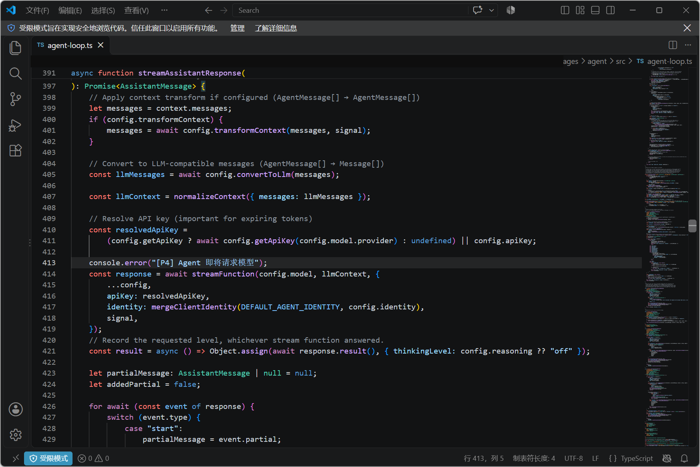
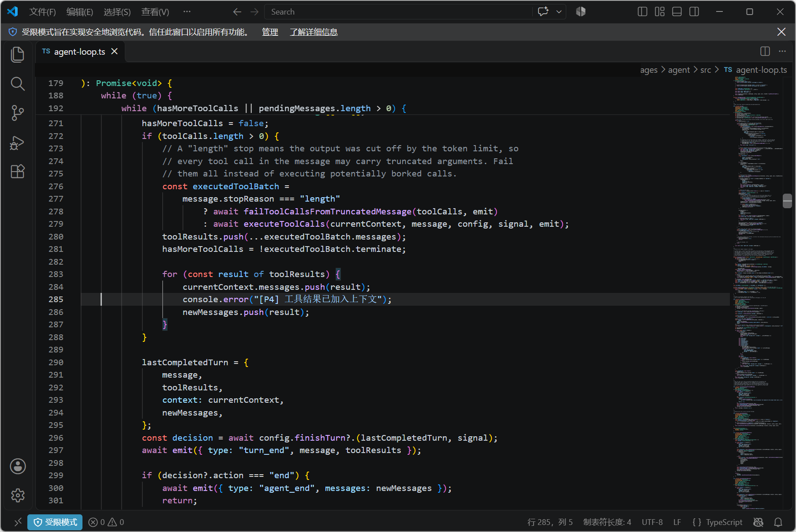
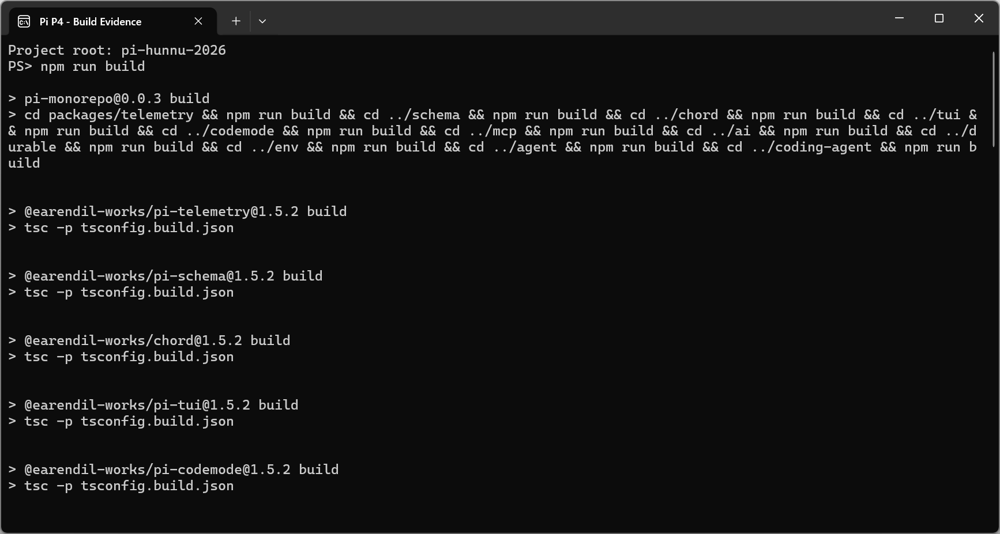
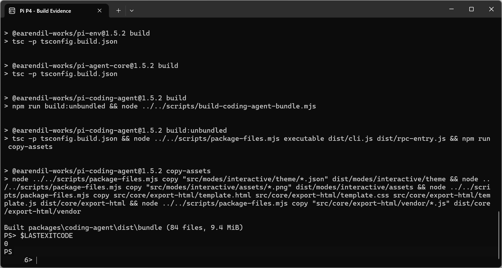
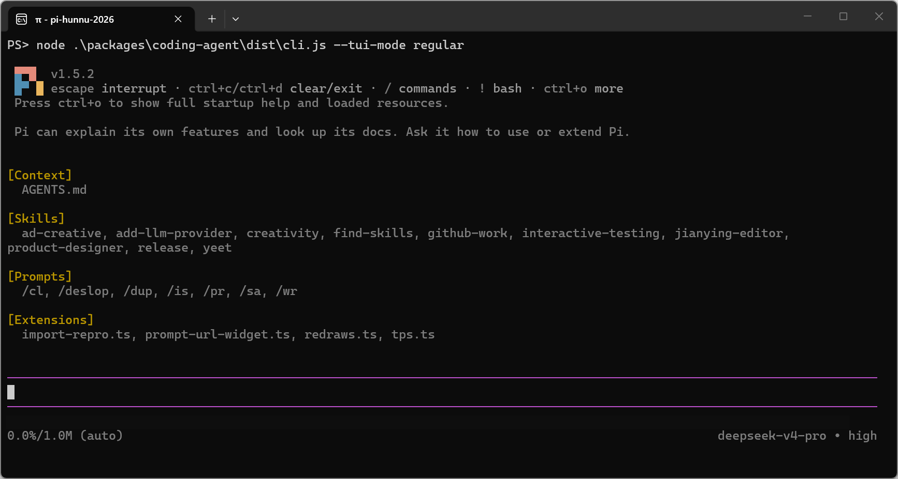
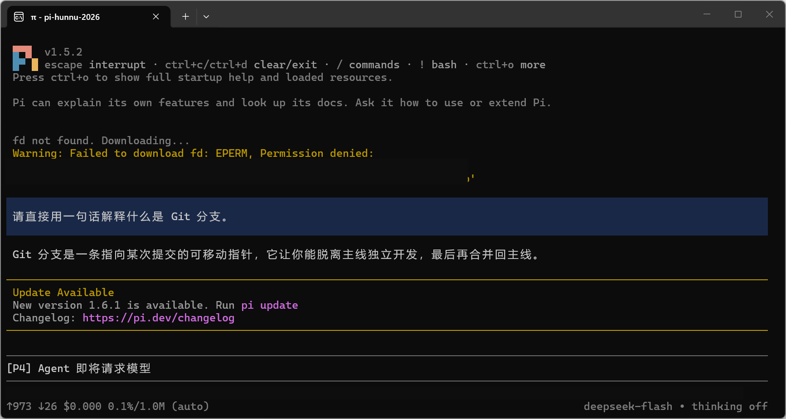
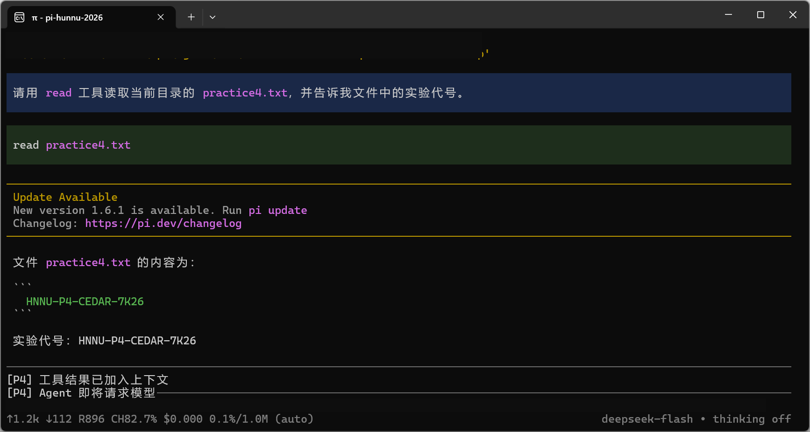
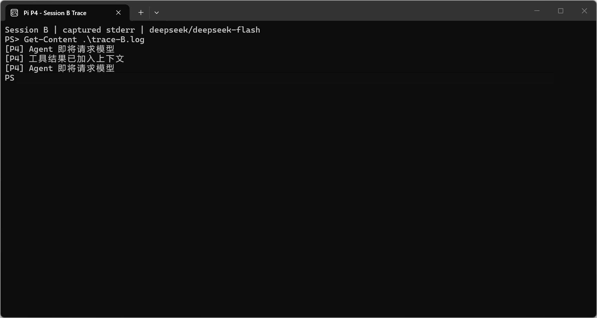
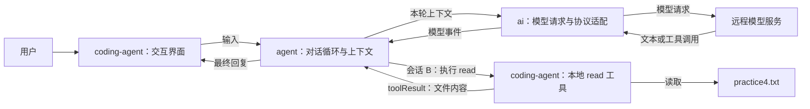

# 实践课 4：Pi Agent 的模型调用与运行流程

GitHub：`Mr-ship` · 2026 年 11 月 26 日

实验环境为 Windows PowerShell、Node.js `v24.18.0`、npm `11.16.0`。在[小组代码仓库](https://github.com/shizishizi111/pi-hunnu-2026)的实践课 3 基线 `c3cc91632d0a1950fb122605b190233f2aa0006e` 上进行实验，本地编译的 Pi 版本为 `1.5.2`。

## 1. 源码修改

在 `packages/agent/src/agent-loop.ts` 增加两行 `console.error`，把日志写到标准错误流：

| 修改后行号 | 插入位置 | 记录的事件 |
| --- | --- | --- |
| 413 | `await streamFunction(...)` 的正上方 | Agent 即将把转换好的上下文交给模型调用函数 |
| 285 | `for (const result of toolResults)` 循环内，紧接 `currentContext.messages.push(result)` | 一条工具结果已加入上下文 |





## 2. 重新编译与启动

在含根 `package.json` 的 `pi-hunnu-2026` 目录运行 `npm run build`，构建完成后读取 `$LASTEXITCODE`，结果为 `0`。随后用 `node .\packages\coding-agent\dist\cli.js` 启动 Pi `v1.5.2`。S4 追加 `--tui-mode regular`，使启动命令和交互界面同时留在终端中。







公开版截图已遮盖本机路径。

## 3. 两次会话的实测记录

在项目根目录创建 `practice4.txt`，内容为一行 `HNNU-P4-CEDAR-7K26`。A、B 分别从新会话启动，均使用 `deepseek/deepseek-flash`，思考级别为 `off`，可用工具均设为 `read`。两次会话均关闭扩展、技能、提示模板和项目上下文文件的自动加载。B 的提示词只提供文件名。

### A：直接问答

输入：请直接用一句话解释什么是 Git 分支。

**未调用工具，进入 1 轮模型调用。** 标准错误流中只有一条 `[P4]` 日志：

```text
[P4] Agent 即将请求模型
```

Pi 的最终回复：

> Git 分支是一条指向某次提交的可移动指针，它让你能脱离主线独立开发，最后再合并回主线。



### B：读取文件

输入：请用 `read` 工具读取当前目录的 `practice4.txt`，并告诉我文件中的实验代号。

**调用 1 次 `read`，进入 2 轮模型调用。** 第一次模型回复发出 `read` 调用，路径为 `practice4.txt`。工具成功返回 `HNNU-P4-CEDAR-7K26`，第二次模型回复给出相同的代号。

本次运行的完整 `[P4]` 日志顺序如下。S6a 的界面显示后两条日志，S6b 显示同一次运行从标准错误流同步保存的全部三条。

```text
[P4] Agent 即将请求模型
[P4] 工具结果已加入上下文
[P4] Agent 即将请求模型
```

Pi 的最终回复：

> 文件 `practice4.txt` 的内容为：
>
> ```text
> HNNU-P4-CEDAR-7K26
> ```
>
> 实验代号：**HNNU-P4-CEDAR-7K26**





## 4. 调用流程对比

| 会话 | 首轮模型输出 | 本地工具 | 后续模型调用 |
| --- | --- | --- | --- |
| A | 一句 Git 分支定义 | 无 | 无，总计 1 轮 |
| B | `read` 工具调用 | 本机 Pi 执行 `read`，读取项目根目录里的文件 | 带着工具调用和对应结果再请求 1 轮，总计 2 轮 |

B 中实际打开文件的是本机 Pi 的 `read` 工具，由 `coding-agent` 提供，`agent` 根据第一轮模型返回的工具调用执行它。`read` 返回包含文件内容的 `toolResult`。`agent` 把该结果追加到 `currentContext.messages`，打印“工具结果已加入上下文”，下一轮再通过 `ai` 适配层向远程服务发起请求。相比首轮，下一轮的上下文保留原始输入，并多带了上一轮模型的 `read` 调用和与它对应的工具结果，其中包含文件中的实验代号。



两条日志的计数口径不同。“即将请求模型”按 Agent 到达调用位置的次数计数，“工具结果已加入上下文”按写入的结果条数计数。B 中后两条日志相邻，说明工具结果先写入上下文，随后才进入下一轮模型调用。

补充验证中，`agent-loop.test.ts` 的 40 项测试通过。额外运行的仓库级 `npm run check` 在 `packages/ai/test` 中遇到模型 ID 的 TypeScript 类型错误，以上构建与交互记录来自单独执行成功的 `npm run build` 及其产物。
